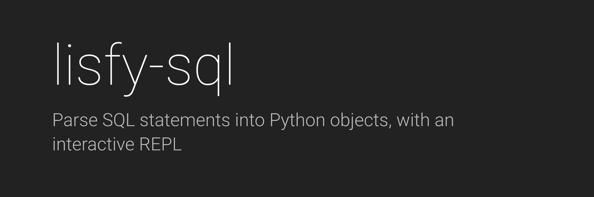

<p align="center"></p>
<p align="center"><strong>Parse SQL statements into Python objects, with an interactive REPL</strong></p>
<p align="center"><a href="https://github.com/conao3/python-lisfy-sql/stargazers"></a></p>
<p align="center"><a href="#installation">Installation</a> | <a href="#usage">Usage</a> | <a href="#development">Development</a> | <a href="#license">License</a></p>
<h1>lisfy-sql</h1>

A SQL parser for Python with an interactive REPL interface.

## Overview

lisfy-sql parses SQL statements into structured Python objects using a streaming tokenizer approach. It supports common SQL statement types including SELECT, INSERT, UPDATE, DELETE, and CREATE.

## Requirements

- Python 3.11 or higher

## Installation

```bash
pip install lisfy-sql
```

Or install from source using Poetry:

```bash
git clone https://github.com/conao3/python-lisfy-sql.git
cd python-lisfy-sql
poetry install
```

## Usage

### Interactive REPL

Start the interactive SQL parser:

```bash
lisfy-sql
```

This opens a REPL where you can enter SQL statements:

```
lisfy-sql> SELECT * FROM users
```

### Programmatic Usage

```python
from lisfy_sql import rep

# Parse and evaluate a SQL statement
result = rep.rep("SELECT * FROM users")
print(result)
```

## Development

Install development dependencies:

```bash
poetry install
```

Run type checking:

```bash
mypy src/
```

## License

Apache-2.0
